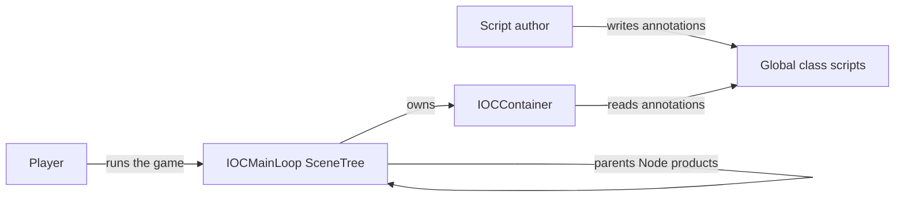
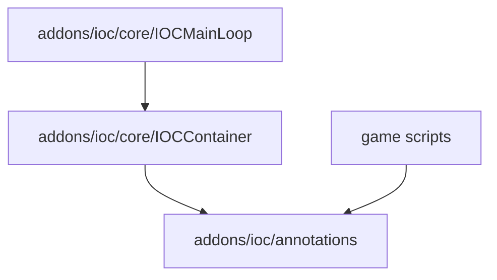
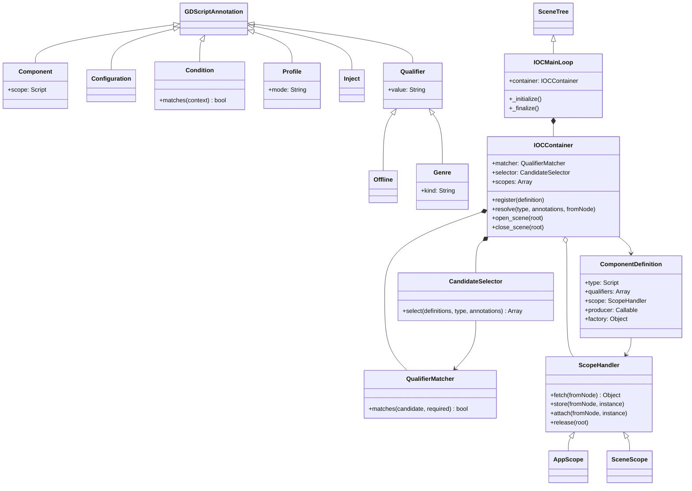
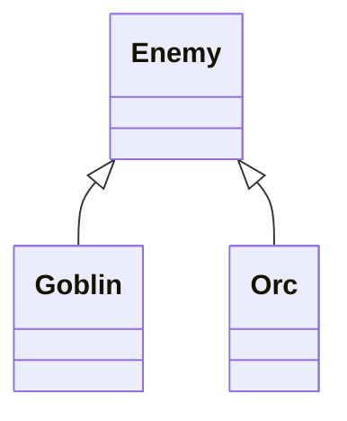
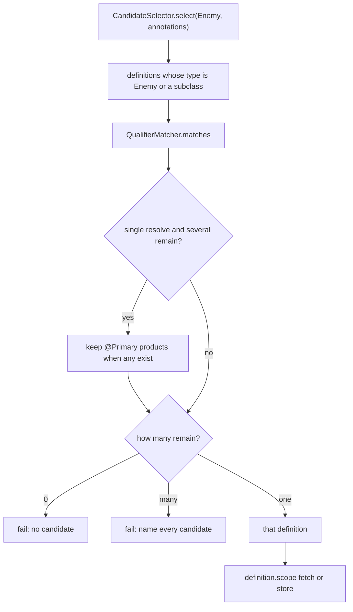
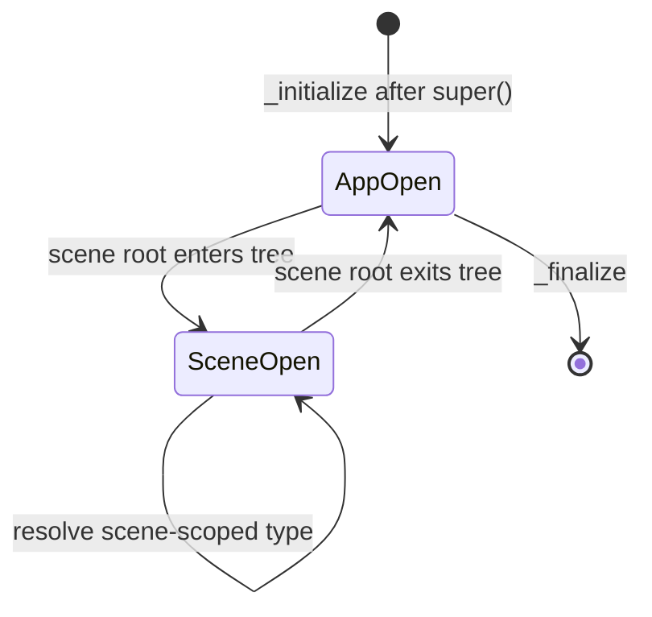
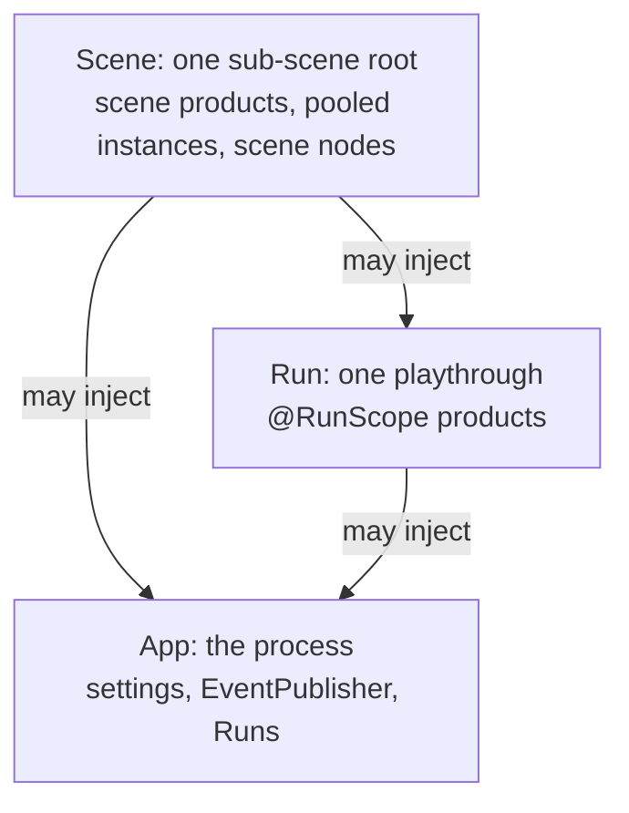
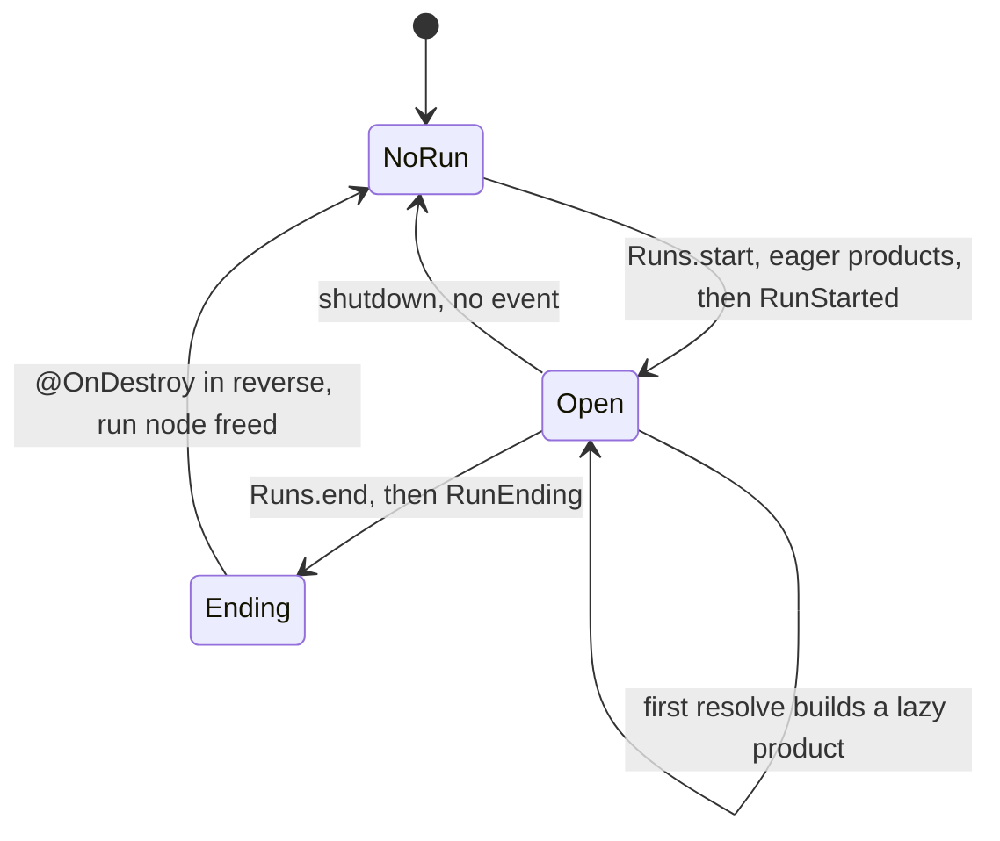
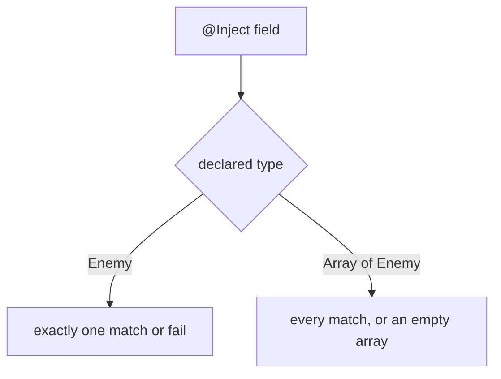

# IOC architecture

Working plan for `addons/ioc` in this project. It uses the user-annotation APIs on Godot branch `cursor/gdscript-user-annotations-8b9e`.

The current stubs still have `Configuration` extending `Component`, and `IOCMainLoop` extending `MainLoop` with no `class_name`. This plan replaces that.

## Decisions

`@Configuration` is a factory. It does not extend `@Component`. The scanner instantiates each configuration class once, at app scope, and treats that object as the factory.

`@Component` is the only product mark.

- On a class, the product is that class. The container calls `new()` on the script.
- On a method, the product is the method's return value. The container calls the method on the factory. This is the factory method. There is no separate `@Bean`.

`@Inject` is the injection mark. It sits on a field, on an `_init` parameter, or on a factory-method parameter. `@Component` does not inject.

A dependency asks for a type. Every registered component whose type is that type, or a subclass of it, is a candidate. One subclass is enough. The parent class does not need its own `@Component`. Godot has no interfaces, so the parent is a base class. The container walks `get_base_script()` to decide.

A factory method's type is the declared return type. `-> Goblin` matches a request for `Goblin` and for `Enemy` when `Goblin` extends `Enemy`. `-> Enemy` matches `Enemy` only. The container does not guess a narrower runtime class from the method body.

When more than one candidate matches, qualifier annotations pick one. `@Qualifier` is the built-in annotation, and its `value` string is an ordinary attribute. A user qualifier is another annotation class that extends `Qualifier`, for example `@Offline` or `@Genre` with its own attributes. The container does not special-case the string. `AnnotationUtils` already returns a subclass use when the query class is the base, so a query for `Qualifier` sees `@Offline` and `@Genre`.

Each qualifier annotation on the injection point must be satisfied by one on the candidate: same annotation class, same attribute values. Extra qualifier annotations on the candidate are fine. Qualifier does not replace the type check. Zero candidates fail. Several candidates that remain after the qualifier check fail unless exactly one of them is `@Primary`, or several are `@Primary` and that set is still larger than one. The failure names the candidate scripts that remain.

The container does not inline that comparison. `QualifierMatcher`, `CandidateSelector`, and `ScopeHandler` are the policies. A custom qualifier annotation uses the default matcher. A user who needs a different comparison subclasses `QualifierMatcher`. Subclassing and calling `super` keeps the default and adds a rule.

Factory-method parameters and `_init` parameters are resolved before the call. `@Inject` fields are filled after `new()` and before the instance is published into its scope. If resolve re-enters a definition already being created, the container fails. It does not build a proxy.

Conditions and profiles are their own annotations. The factory reads every annotation on the class or the method before it registers a definition. `@Profile` means a run mode (client, dedicated server, editor, or a project feature tag). `@ConditionalOn*` means a yes-or-no check against a setting, a registered type, or a node present in the active scope. Those annotations are not folded into `@Component`.

Three scopes:

- **App.** One instance for the process. A `Node` is parented to the scene-tree root. A `RefCounted` is held by the container.
- **Run.** One instance per playthrough. `@RunScope` marks the product, and `Runs` opens and ends the run. It outlives a scene change and is dropped on a new game. A `Node` is parented under the run node. The run scope section below has the rules.
- **Scene.** One instance per sub-scene root, keyed by that root's instance id. Not one instance per `PackedScene` resource. The root is the nearest node, including the caller itself, whose `scene_file_path` is not empty. That is the root of the instanced sub-scene. A node written directly in the running scene uses the running scene's root, which has a `scene_file_path` too. A node with no such ancestor has no scene scope, and a scene-scoped resolve from it fails.

The scene tree owns one container. The tree owns node lifetime. The container is the lookup index. It holds `RefCounted` instances itself. It does not parent nodes, and it does not keep a second owning reference to a node.

`IOCMainLoop` is a `SceneTree` with a `class_name`, selected by `application/run/main_loop_type`. `_initialize` calls `super()` first, then discovers definitions.

Discovery uses `ProjectSettings.get_global_class_list()`, then `AnnotationUtils` on each script. There is no project-wide annotation index. Scripts with no `class_name`, and inner classes, are out of this scan.

## Context



## Modules

Allowed dependency: annotations depend on nothing in this addon. The container depends on annotations only through `AnnotationUtils` at runtime. The main loop depends on the container. Sample game scripts depend on the annotations. They do not depend on the container type.



## Classes



`Offline` and `Genre` are examples a game writes. They are not part of the addon.

`Configuration` and `Component` are siblings. A component query does not match a configuration. A configuration class can still expose products, because those products are `@Component` methods, not the configuration annotation itself.

## Policies

The container calls a policy object. It does not contain a second copy of the rule.

| Policy | Default | How a user extends it |
| --- | --- | --- |
| `QualifierMatcher` | Same annotation class, same attribute values. Each required annotation needs one match. | A subclass of `Qualifier` needs no new matcher. One global subclass of `QualifierMatcher` replaces the default. |
| `CandidateSelector` | Assignable type, then the matcher. For a single resolve, several remaining definitions narrow to `@Primary` when any exist. | One global subclass replaces the default. |
| `Condition` | The annotation's `matches` method. | A subclass such as `@ConditionalOnProperty` is the check. The container calls `matches` on each one it finds. |
| `ScopeHandler` | `AppScope` and `SceneScope`. | Every concrete global subclass is installed, including the two built-ins. `@Component.scope` names the handler script. |

Policy classes are found in the global class list before any product is registered. A policy class is not a product. `@Component` on it is ignored. Zero user subclasses of `QualifierMatcher` or `CandidateSelector` keeps the built-in. Two user subclasses of either one fail at startup and name both scripts. `ScopeHandler` does not use that replacement rule, because App and Scene stay present when a user adds another handler.

```mermaid
sequenceDiagram
    participant Loop as IOCMainLoop
    participant Scan as Global class list
    participant Box as IOCContainer

    Loop->>Scan: get_global_class_list()
    Loop->>Box: default QualifierMatcher and CandidateSelector
    alt one user subclass
        Loop->>Box: replace that policy with the subclass
    else several user subclasses
        Loop-->>Loop: fail and name them
    end
    Loop->>Box: install every ScopeHandler subclass
```

`Condition` is the base. `matches` receives a `ConditionContext`. `environment` is the property environment. `registry()` is a copy of the products visible to that check, so a condition can read labels, types, and qualifiers without changing registration. A condition that reads the registry overrides `depends_on_registry`. The copy is taken after every definition that does not read the registry exists, so the candidate and other deferred products are absent. `@Condition([OnTownMusic, OnGameClock])` constructs each listed class and requires every one to match. A listed class that reads the registry defers the whole annotation. A listed class that waits for a scene defers it the same way. `@ConditionalOnProperty`, `@ConditionalOnFeature`, `@ConditionalOnClass`, `@ConditionalOnMissingClass`, `@ConditionalOnComponent`, `@ConditionalOnMissingComponent`, `@ConditionalOnResource`, `@ConditionalOnNode`, and `@ConditionalOnMissingNode` are the checks. The container does not special-case the subclass name. It asks each condition annotation on the target whether the definition may be registered.

`ComponentDefinition.type` is the component script, or the factory method's declared return type. `qualifiers` is every annotation on that class or method that extends `Qualifier`, each with its attributes. The container keeps a list of definitions. It does not key that list by exact script, because a request for a parent type must see every subclass.

## Type match



`Goblin` and `Orc` are both `@Component`. A dependency typed as `Enemy` sees both. A dependency typed as `Goblin` sees only `Goblin`.



`@Qualifier("brute")` on `Orc` and on the `Enemy` parameter selects `Orc`, because `value` is `"brute"` on both. `@Offline` on `Orc` and on the parameter selects `Orc` with no string. `@Genre("boss")` matches only a candidate whose `@Genre.kind` is `"boss"`. The same parameter with no qualifier annotation fails while both subclasses are registered. If `Goblin` is the only `Enemy`, the parameter needs no qualifier. A custom matcher is what runs inside `QualifierMatcher.matches`. The selector does not know the annotation classes.

`@Primary` marks a preferred product when several still match after the type and qualifier checks. The mark sits on a `@Component` class or on a factory method. A single resolve keeps only the primary products when any exist. Zero primaries among several matches still fails. Several primaries that remain still fail. A typed `Array` injection skips that step and returns every match. A qualifier on the injection point still wins when it leaves one candidate. `@Primary` on a `@Configuration` class, on a field, on a method that is not a factory method, or without `@Component` is `push_error`.

## Registration

```mermaid
sequenceDiagram
    participant Loop as IOCMainLoop
    participant Tree as SceneTree
    participant Scan as Global class list
    participant Utils as AnnotationUtils
    participant Box as IOCContainer
    participant Factory as Configuration instance

    Loop->>Tree: super()._initialize()
    Loop->>Box: new IOCContainer
    Loop->>Box: install policies
    Loop->>Scan: get_global_class_list()
    loop each GDScript
        Loop->>Utils: has_annotation(script, Configuration)
        alt configuration class
            Loop->>Factory: script.new()
            Loop->>Utils: for_each_annotation_initialized(Component, script)
            Utils-->>Loop: annotation, FunctionInfo or ScriptInfo
            Loop->>Loop: read Condition, Profile, and every Qualifier subclass on that target
            alt conditions pass
                Loop->>Box: register(ComponentDefinition)
            end
        else class-level Component
            Loop->>Utils: has_annotation(script, Component)
            Loop->>Loop: read Condition, Profile, and every Qualifier subclass on the class
            alt conditions pass
                Loop->>Box: register(producer = script.new)
            end
        end
    end
```

Class-level `@Component` on a `@Configuration` class is ignored. The configuration object is the factory, created above, not a second product.

Method-level `@Component` is valid only on a configuration class. On any other class the scanner skips it.

## Resolve

```mermaid
sequenceDiagram
    participant Node as Caller node
    participant Box as IOCContainer
    participant Select as CandidateSelector
    participant Scope as ScopeHandler
    participant Producer as producer Callable

    Node->>Box: resolve(Type, annotations, fromNode)
    Box->>Select: select(definitions, Type, annotations)
    alt zero or several candidates
        Box-->>Node: fail
    else one candidate
        Box->>Scope: fetch(fromNode)
        alt instance exists
            Box-->>Node: existing instance
        else
            Box->>Box: resolve each producer parameter
            Box->>Producer: call()
            Box->>Box: fill @Inject fields
            Box->>Scope: attach and store
            Box-->>Node: instance
        end
    end
```

The caller passes the node it is running on. The selector runs before the scope cache. `SceneScope` walks parents to the sub-scene root (`scene_file_path` not empty). `AppScope` ignores that root. A scene-scoped `Node` is parented under the sub-scene root. An app-scoped `Node` is parented under the tree root. A `RefCounted` is stored by the handler and is not parented. A user `ScopeHandler` decides its own key, parent, and release.

## Creation and `@onready`

`@Component` is not a base class. The script keeps extending `Node`, `RefCounted`, or a more specific type such as `CharacterBody2D`. The container does not invent a component superclass, because a scene node has to stay the node type the scene expects.

Who creates the object decides when `@Inject` can run. `@onready` is a third path and stays what it is.

| | Who creates it | When `@Inject` is filled | `@onready` |
| --- | --- | --- | --- |
| `RefCounted` `@Component` | Container `new()` | Before the instance is published. It never enters the tree. | Does not apply. There is no tree and no `$` path. |
| `Node` `@Component` | Container `new()`, then the scope handler parents it | After `new()`, before `add_child`. `_ready` can use the fields. | Still runs for this node's own children after it enters the tree. |
| `@Scene` `@Component` | Container `instantiate()`, then the scope handler parents the root | After `instantiate()`, before `add_child`. A child is filled when it enters. | The scene's own `@onready` paths still run. |
| Node already in a scene | Godot instances the `PackedScene` | When that node enters the tree, before `@onready` and `_ready`. The container does not call `new()` again. | Unchanged. `$HealthBar` is still an `@onready` path. |
| Node that is both | Do not. The scene and the container would each make an instance. | — | — |

`@onready` binds a node that is already in this scene, by path, at ready time. `@Inject` binds a container product, by type and qualifier. A scene script uses `@onready` for its children and `@Inject` for a service that is not a child. Neither annotation does the other job.

A scene node with `@Inject` is a consumer, not a product. It does not need `@Component`. `@Component` on a `Node` means the container spawns that node under the scope root. The node painted in the editor is the scene's instance, and the container only fills its `@Inject` fields.

```mermaid
sequenceDiagram
    participant Scene as PackedScene
    participant Node as Scene node
    participant Box as IOCContainer
    participant Ready as at-ready

    Scene->>Node: instantiate
    Node->>Box: enters the tree
    Box->>Box: fill @Inject fields by type
    Node->>Ready: @onready paths, then _ready
```

A `RefCounted` product skips this sequence. Nothing enters the tree, so the container fills `@Inject` at `new()` and `@onready` never runs. A container-spawned `Node` is filled before `add_child`, so its `_enter_tree` and `_ready` already see the injected fields. Children inside a scene that a factory instantiated still use the enter-tree pass, because the factory did not construct those children through the container.

## Scope lifecycle



`close_scene` calls `release` on every installed `ScopeHandler`. `SceneScope` drops that root's map. A user handler releases whatever key it stored for that root. Node products under the root are freed by the tree. The container does not free them again. `RefCounted` products for that scene are released with the map.

## Run scope

A run is one playthrough. It opens on a new game and ends on game over or on the way back to the menu. A run product keeps its state across scene changes and loses it when the run ends, so the next run starts from defaults.



An arrow is an allowed injection. A longer-lived product does not hold a shorter-lived one. An app product reads the run at call time with `Runs.resolve`.



`Runs.restart` is `end` followed by `start`. When no run is open it only starts one.

```mermaid
sequenceDiagram
    participant Game as Gameplay
    participant Runs
    participant Box as IOCContainer
    participant Product as Run product
    participant Node as IocRun

    Game->>Runs: start()
    Runs->>Box: start_run()
    Box->>Node: new node under IocRuns
    Box->>Product: eager products before RunStarted
    Box-->>Game: RunStarted to app, run, and open scenes
    Game->>Box: resolve(Wallet) from a scene node
    Box->>Product: new(), fill @Inject from the run node
    Box->>Product: @Ready
    Game->>Runs: end()
    Box-->>Game: RunEnding, products still there
    Box->>Product: @OnDestroy, reverse publish order
    Box->>Node: remove from the tree, free after the frame
```

## What the container stores

| Kind | App | Run | Scene |
| --- | --- | --- | --- |
| Node | Child of the tree root. Container stores the lookup. | Child of `IocRun`. Freed with that node when the run ends. | Child of the scene root. Container stores the lookup. |
| RefCounted | Held in the app map. | Held in the run map until the run ends. | Held in the scene map until the root exits. |

## First slice

The first running slice uses only the decisions above that it needs.

It includes `IOCMainLoop` as a `SceneTree`, `@Configuration` separate from `@Component`, discovery of global classes, app scope, class products and factory methods, injection of factory parameters, `_init` parameters, and `@Inject` fields on objects the container itself creates, parent-type matching, and the default qualifier matcher including a user subclass of `@Qualifier`. `QualifierMatcher`, `CandidateSelector`, and `AppScope` exist as the objects the container calls. A factory method with no declared return type is a registration error. A missing or ambiguous candidate is `push_error` with the candidate scripts named, and `resolve` returns null. The sample is one app-scoped `Node`, one `RefCounted`, two subclasses of one parent, and one `@Qualifier` that selects between them.

It does not include scene scope, conditions, profiles, a custom `ScopeHandler`, or a replacement policy.

## Second slice

A node Godot already created is filled from `SceneTree.node_added`. That signal runs after `_enter_tree` and before `@onready` and `_ready`. The container does not call `new()` for that node. `@Inject` fields are resolved by type and qualifier. `@onready` is left to Godot.

A scene node whose script is also a class `@Component` is refused. The container would create a second instance. The scene instance is not filled.

A child inside a scene that a factory instantiated is not constructed by the container. It uses the same enter-tree fill once that scene enters the tree. `RefCounted` products never enter the tree, so they stay on the creation path. A `Node` the container spawned is still filled before `add_child`. When it later enters the tree, `node_added` sees the stored instance and does not fill it again.

## Collection injection

A single `@Inject` dependency still needs exactly one match. A typed array asks for every match.

```gdscript
@Inject var boss: Enemy
@Offline
@Inject var pack: Array[Enemy]
```

`boss` fails when the count is not one. `pack` receives every `Enemy` that carries `@Offline`, including a subclass such as `Wolf`. No qualifier on the array means every `Enemy`. Several qualifier annotations on the array are all required, the same rule as a single dependency. An empty match is an empty array. That is a wave with no members, not a missing dependency.

Godot has no set type. The array is the list. Each product definition appears once, so the array is already unique by product. Order is the registration order and is not a promise. A map keyed by qualifier is not this rule.

`VariableInfo` stores the array type and not the element type. The element type is the `PROPERTY_HINT_ARRAY_TYPE` hint on `get_script_property_list()`. An untyped `Array` has no element type and is a registration error. The same declaration works on a field, an `_init` parameter, and a factory-method parameter.

Resolving the array creates each matching product in the caller's scope. With only app scope, that is the one app instance of each match. When scene scope exists, a list resolved from a scene node includes the app instances and that scene's instances, and not another scene's instances. A member that is already being created fails the whole injection, the same cycle rule as one dependency.



## Property environment

The container builds a `PropertyEnvironment` in `setup`, before discover. The name is not `Environment`, because that is Godot's rendering resource. Conditions will read it later. They do not resolve a bound settings object.

A `PropertySource` is one named origin. `contains(key)` is how a missing key differs from a stored null. The source at index 0 wins. `add_first` inserts there. `PropertySourceParser` turns a path into a source. The first parser whose `handles` returns true reads the file. A custom format is another parser.

This slice loads `res://config/*.cfg` through `ConfigFile`. Each entry is `section/key`. File names sort ascending, and each file is inserted at index 0, so the last name wins. A key only the earlier file has still comes from that file. A missing directory loads nothing. A file that fails to parse is skipped after `push_error`.

`@ConfigurationProperties(prefix="audio")` marks a `Resource` or `RefCounted`. It registers nothing by itself. `@ConfigurationPropertiesScan(root="res://samples/ioc")` on a `@Configuration` class opts in for game settings. A script path matches when it equals the root or sits under `root/`. At the end of discover the binder constructs each match, writes `@export` fields, and stores the instance in app scope. Framework `IocProperties` is bound earlier by the container itself, without that scan. A normal `@Component` stays lazy. Fields are `int`, `float`, `bool`, `String`, or a `Resource`. The key is `prefix/field`. A missing key keeps the field default. An `int` may fill a `float`. Any other mismatch is a `push_error` and that product is not published. A key with no `@export` field is ignored. A field that is not `@export` is left alone. Gameplay receives the object with `@Inject`.

ProjectSettings, the OS environment, and the command line sit above the files, in that order, with the command line at index 0. `ProjectSettings` uses the same `section/key`. `AUDIO_MASTER` matches `audio/master`, and the value stays the raw string. `--audio/master=0.2` after `--` is a command-line entry. A key none of these set still falls through to the cfg files.

The binder holds an ordered `PropertyConverter` list. The first converter whose `handles` returns true produces the stored value. A result of the wrong type fails the product. `ScalarPropertyConverter` is always last. It passes a matching type through, fills a float from an int, and parses a whole string into an int, a float, or a bool. `"true"` and `"false"` are the only bool spellings. `ResourcePropertyConverter` sits immediately in front of it. A `res://` string is loaded into a `Resource` field. A value that is already that class, or a subclass of it, passes through. A missing file, a different class, and a path outside `res://` drop the product. `Node`, `RefCounted`, and arrays stay rejected. The container installs every other concrete global subclass of `PropertyConverter` in front of those two. `PaceConverter` maps `"slow"` and `"fast"` onto an int, which the resource converter leaves alone. A settings object does not receive a converter through `@Inject`.

After conversion, the binder calls `Preparer.prepare` when that global class exists, then `Validator.validate`. `Preparer` lives in `addons/prepare` and does not import this addon or the validation addon. Preparations on one field run in source order, and each one sees the previous result. A value of the wrong kind is left unchanged. A result the field cannot store, or a preparation that fails, drops the settings object and skips validation. A project without that class still binds. The built-in preparations are `Trim`, `Collapse`, `Lower`, `Upper`, `Clamp`, `RoundTo`, `SimplifyPath`, `Normalize`, and `LimitLength`. `Normalize` and `LimitLength` apply when `Preparer` is called on a real object. The binder stores `int`, `float`, `bool`, `String`, and `Resource`.

`Validator` lives in `addons/validation` and does not import this addon. A violation drops the settings object. A project without that class still binds. The built-in checks are `NotNull`, `NotEmpty`, `Min`, `Max`, `Pattern`, `ValueRange`, `OneOf`, `File`, `Dir`, `Layers`, `AudioBus`, `InputAction`, and `Locale`. `ValueRange` follows `@export_range`, including step, `or_greater`, and `or_less`. The GUI class already owns the name `Range`.

`res://config/*.tres` is the lowest layer. The loader duplicates the resource, then flattens each `@export` to `prefix/field` from `@ConfigurationProperties` on its script. A cfg file, `ProjectSettings`, the OS, and the command line still win when they have the same key. The cached `.tres` is left unchanged. A resource without the annotation is skipped after `push_error`.

`@ConditionalOnProperty` reads one environment key while a class, a factory method, or a settings object is registered. It does not resolve the bound settings object. An empty `having_value` matches a present value other than false. `having_value` compares a bool as `true` or `false`, ignoring case, and compares every other value as text. `match_if_missing` matches only when the key is absent. A present value is still compared. Several conditions on the same target all have to match. A failed check skips that definition and does not push an error. A failed check on a `@Configuration` class skips its factory methods and its property scan. The annotation is repeatable.

`@ConditionalOnFeature` matches when `OS.has_feature` has the named tag. `editor`, `debug`, `template`, `dedicated_server`, `mobile`, `web`, and a custom export tag all use it. This is the profile check. A missing tag skips the definition. Several feature conditions on one target all have to match. A failed check on a `@Configuration` class skips its methods and its property scan.

`@ConditionalOnClass` matches when the named native class, extension class, or global `class_name` exists. `@ConditionalOnMissingClass` matches when that name is absent. The name is text, because a script cannot mention a type that is not installed. This is for an addon boundary such as a third-party global class. It does not ask whether this container registered a component. Several class conditions on one target all have to match. A failed check skips the definition, and a failed check on a `@Configuration` class skips its methods and its property scan.

`@ConditionalOnComponent` matches when a registered product is the named global class or a subclass of it. `@ConditionalOnMissingComponent` matches when no such product is registered. Both wait until every definition that does not read the registry has been registered. The candidate does not count itself, and neither does another product that also reads the registry, so scan order cannot decide. A name that is not a global GDScript class is `push_error` and does not match. A failed earlier condition still skips the definition before that pass. A failed check on a `@Configuration` class skips its methods and its property scan.

`@ConditionalOnResource` matches when the `res://` file or directory exists. A cfg file counts, because the check is the path, not a loaded `Resource`. A missing path skips the definition. A path that does not start with `res://` is `push_error` and does not match. Several resource conditions on one target all have to match. A failed check on a `@Configuration` class skips its methods and its property scan.

`@ConditionalOnNode` matches when the entering scene root, or a descendant that belongs to that scene, uses the named global class or a subclass of it. `@ConditionalOnMissingNode` matches when that scene has no such node. A nested scene root is not searched, because it is its own scene. Both wait until the root enters, so discovery does not decide them. The admitted products are stored on that root, not in the app list. `resolve` without a node uses the current scene. A second scene root gets its own products. When the root leaves the tree, those products leave with it. A name that is not a global GDScript `Node` class is `push_error` and does not match. Several node conditions on one target all have to match. A failed check on a `@Configuration` class skips its methods for that scene. A general `SceneScope` handler is still later.

`@EventListener` marks a method on a component. The method takes one parameter whose type extends `Event`. That type is the channel. A publish calls every visible listener whose parameter type is that class or a superclass, so a listener of `Event` hears every event. `EventPublisher` is an app product the container registers, and gameplay injects it. `publish(event)` reaches app listeners. `publish(event, from_node)` also reaches listeners of that node's scene. A listener is registered when its component instance is published, and a scene listener leaves with the scene root. The call is synchronous unless the method is also `@Async`. `@Async` may `await`. `publish` returns before that method finishes, and a returned `Event` is published when it finishes, on the same node. That resume stays on the main thread. A listener that awaits without `@Async` is `push_error` and its later return is not published. `@Async` on anything other than an `@EventListener` method is `push_error`. While an `@Async` listener is still suspended, another publish of that same event class is `push_error`. A null return publishes nothing. A returned value that is not an `Event` is `push_error` and is not published. If that event type is already being published, the container `push_error`s and stops, so a listener cannot hear its own result. `Event` is abstract and is not a `@Component`. A method that is static, takes anything other than one `Event`, or sits on a `@Configuration` is `push_error` and is not called.

`@Ready` and `@OnDestroy` mark a method on a published product that is not a `Node`. `@Ready` runs once, after `@Inject`, when the instance has been stored and its listeners, ticks, schedules, input, and signals are armed. A second `resolve` does not call it again. `@OnDestroy` runs when a scene product's scene root leaves, and at shutdown for an app product and for any scene product still open. Scene products are destroyed before app products. Across products the destroy order is the reverse of the order they were published, so a dependent runs while its dependency is still there. On one product the methods run in source order, and a base script's methods run after the derived script. The method takes nothing. The return value is ignored. A method that awaits is `push_error`. A `Node` product, a static method, a method on a `@Configuration`, a method on a `@Pooled` component, and a method that takes arguments are `push_error` and are not called. `@Ready` or `@OnDestroy` on a class, a field, or a parameter is `push_error`. A call on the published instance hits advice when that method is woven.

`@OnSceneEnter` and `@OnSceneExit` mark a method on a published app product that is not a `Node`. The method takes the scene root. A `Node` parameter receives every scene. A `Node` subclass receives a root of that class. `@OnSceneEnter` runs when a scene root opens, and when the product is published while that scene is already open. That call follows `@Ready`. `@OnSceneExit` runs when the root leaves, and at shutdown for a scene that is still open, before that scene's products are destroyed. The last opened scene exits first. Across products the order is the order they were published. On one product the methods run in source order, and a base script's methods run after the derived script. The return value is ignored. A method that awaits is `push_error`. A `Node` product, a scene product, a static method, a method on a `@Configuration`, a method on a `@Pooled` component, and a method that does not take one `Node` are `push_error` and are not called. `@OnSceneEnter` or `@OnSceneExit` on a class, a field, or a parameter is `push_error`. A call on the published instance hits advice when that method is woven.

`@Process` and `@PhysicsProcess` mark a method on a published product that is not a `Node`. The method takes one float, the delta for that clock. The container parents one `FrameDriver` to the tree root. That node is not a product. Its `_process` calls every `@Process` method, and its `_physics_process` calls every `@PhysicsProcess` method. The node keeps the normal process mode, so a paused tree skips both lists. A method is registered when its instance is published. An app product stays for the run. A scene product leaves with the scene root. App products run first, then each open scene. On one product the methods run in source order, and a base script's methods run after the derived script. Across products the order is the order they were published. A method may carry both marks and then runs on both clocks. The return value is ignored. A method that awaits is `push_error`. A `Node` product, a static method, a method on a `@Configuration`, and a method that does not take one float are `push_error` and are not called. A call on the published instance hits advice when that method is woven.

`@Scheduled` marks a method on a published product that is not a `Node`. The string is `500ms`, `1.5s`, `10f`, `10pf`, or six cron fields with the second first. `ms` and `s` add the idle delta. `f` counts idle frames. `pf` counts physics frames. The first call waits one full period. A long delta calls the method once and keeps the remainder. Cron uses the machine's local time. A star is any value. A number, a range, a list, and a step are the other forms. Sunday is `0`, and `7` is Sunday too. When both the day of month and the day of week are restricted, either one matching is enough. The idle frame checks cron, and a matching second calls the method once. A second that passes while the tree is paused is not replayed. The frame node calls idle schedules after `@InputAction` and before `@Process`, and physics schedules before `@PhysicsProcess`. The method takes nothing. The return value is ignored. A method that awaits is `push_error`. The mark is repeatable, and each schedule keeps its own counter. A method is registered when its instance is published. An app product stays for the run. A scene product leaves with the scene root. App products run first, then each open scene. On one product the marks run in source order, and a base script's methods run after the derived script. A `Node` product, a static method, a method on a `@Configuration`, and a method that takes arguments are `push_error` and are not called. `@Scheduled` on a class, a field, or a parameter is `push_error`. An empty string, a delay that is not greater than zero, a fractional frame count, and a string that does not parse are `push_error`. A call on the published instance hits advice when that method is woven.

`@UnhandledInput` marks a method on a published product that is not a `Node`. The method takes one `InputEvent`, or a subclass of it. The container parents one `UnhandledInputDriver` to the tree root. That node is not a product. It implements `_unhandled_input` and does not implement `_input`, so the GUI and every `_input` method see the event first. The node keeps the normal process mode, so a paused tree skips it. A method is registered when its instance is published. An app product stays for the run. A scene product leaves with the scene root. App products run first, then each open scene. On one product the marks run in source order. Across products the order is the order they were published. An empty `action` receives every leftover event. A set `action` receives events the input map binds to that action, and the action must already exist or the mark is `push_error`. `pressed` keeps the press and ignores echo. `released` keeps the release. Either one requires an `action`. Both together are `push_error`. The annotation is repeatable, so one method can list two actions. A subclass parameter drops events of another class before the action check. The return is ignored unless it is `true`, which marks the viewport event handled and skips the remaining methods. A method that awaits, or returns anything other than `bool` or nothing, is `push_error` and does not handle the event. A `Node` product, a static method, and a method on a `@Configuration` are `push_error` and are not called. A call on the published instance hits advice when that method is woven.

`@SignalListener` marks a method on a published `Node` component. The first argument is the signal name. The second is a `NodePath` on that component, and an empty path is the component itself. The container connects the signal from the node's `ready` signal, after `_ready` returns, so a child added in `_ready` is present. A node that is already ready is connected immediately. The method arguments must match the signal. A parameter type accepts that signal argument or a parent of it, so a `Node` parameter accepts a `Node2D` argument. A void return is only the call. An `Event` return is published through `EventPublisher` with the component as the source node. The annotation is repeatable. A missing path, a missing signal, an argument mismatch, an await, and a return that is not an `Event` are `push_error`, and that signal is not connected or its return is not published. A `RefCounted` product, a scene node that is not a component, a static method, and a method on a `@Configuration` are `push_error` and are not connected. A call on the published instance hits advice when that method is woven. The connection leaves with the scene root, and an app connection is dropped at shutdown. The class cannot be named `Signal`, because that name hides the built-in type.

Screens are a separate library. `addons/mvc` does not mention the container. `@Model` marks the state. `@Property` on a field keeps the field an `int`, a `float`, a `bool`, or a `String`. The container reloads that script with a getter and a setter, because a subclass cannot redeclare the field. Advised methods are compiled into that same reload, so the method and the setter are one script. `@View` marks a `@Scene` component. `@Controller` injects that view. `@Bind` fills a field from the view root: an empty path is the unique name equal to the field name, and a `NodePath` is `get_node` from that root. A path that is absolute or contains `..` is `push_error`. `@Ready` then binds in two lines, because GDScript evaluates arguments before the call. `var gold_text := Bindings.text(label)` starts listening, and `gold_text.from(model.gold)` subscribes to that one property. `Bindings.field` and `Bindings.property` do the same. `field` also writes the line back into the property. Two forms fit on one line. `Bindings.link(Bindings.text(label), model.gold)` builds the binder as the first argument, and arguments are evaluated left to right, so it listens before the property is read. `Bindings.text(label).from(func(): return model.gold)` passes a lambda, and `from` calls it while listening. The chained `Bindings.text(label).from(model.gold)` reads the property too early and is `push_error`. `Bindings.on(button.pressed).to(method)` connects that signal. `ScreenHost.show` shows one view and hides the view that was open. A view is hidden when it is published. `addons/ioc_mvc` publishes the host unless one exists, and publishes `MvcHook`. The hook reloads the script before the instance is built, and fills `@Bind` after inject and before `@Ready`. Advice still calls the method, and that method assigns through the setter. `@Property` in `_init`, a field that already has a setter, a `@Controller` that is a `Node`, a `@View` without `@Scene`, a missing node, and a `from` that reads none or two properties are `push_error`. The voice is `MVC:`. An in-place edit such as `items.append` does not assign the field, so it does not notify. When the prepare and validation addons are present, the setter prepares that one field and then checks every constraint on it. `Preparer.prepare_member` and `Validator.validate_member` take the value and do not write the instance. Listeners see the prepared value. A failure keeps the previous value, tells value listeners that previous value, and keeps the message. `var problem := Bindings.error(label)` then `problem.from(model.title)` shows it, and the next accepted assignment clears it. `@ValidationErrorHandler` marks a controller method that takes one `Violation`. It runs for every rejected property of an injected object, including a failure stored before the controller existed. A missing addon stores the value. A preparation failure keeps the `Prepare:` line. A constraint failure is one `MVC:` line per violation. Assigning that same field from inside the check is `push_error`, and the nested write is dropped. `PropertyAdvisor` is a step in that check. Preparation runs at order `-100` and validation at `100`, so a custom advisor sits between them and sees the prepared value. `advise` returns the next value, or a message that keeps the previous value. `Violation.value` is the candidate that failed. `Binder` is the base of a control binding. `Bindings.text`, `field`, `property`, and `error` are binders, and a custom control extends `Binder`.

Saving is a separate library. `addons/serialize` maps `@Serialize` and `@Transient` to a document, then a `Codec` turns that document into bytes. `JsonCodec`, `XmlCodec`, and `BinaryCodec` ship with the library. `Vector2`, `Vector3`, `Color`, `NodePath`, and `StringName` are leaves. A `Sink` stores the bytes in memory or in a file. `ZipBundle` and `DirectoryBundle` sit after the codec and pack named entries. `addons/ioc_serialize` publishes the JSON codec unless a `Codec` product already exists, plus the mapper and a memory sink. `Mapper.read_into` fills an existing instance from bytes. `Mapper.readable` checks that bytes decode as the expected class, so a bad slot can be refused before a run ends. A field advisor, the same shape as `PropertyAdvisor`, is parked. The mapper would run it on one field while writing the document and while reading it back. The codec stays a byte format.

`@Persist` marks a run product that `SaveSlots` may write and load. Fields still opt in with `@Serialize`. `addons/ioc_save` depends on this addon and on `addons/serialize`. `SaveSlots` is an app product. `write`, `load`, `has`, `list`, and `erase` take a slot name of `[A-Za-z0-9_-]`. Each slot is one zip under `SaveSlots.root` (default `user://saves`) through `ZipBundle` and `FileSink`. The zip has a `header` entry listing persisted class names, and one entry per product named by its global class name. `write` saves only already-built `@Persist` products from `IOCContainer.built_run`. It does not resolve a product just to save it. Two built products of the same class are `push_error` and the write fails. `load` decodes every listed entry with `Mapper.readable` first. A bad slot leaves the open run alone. A good slot ends the open run when there is one, releases live pooled holds with `release_pool_holds`, starts a new run, and lets `PersistHook` fill each product in `ContainerHook.before_ready` after inject and before `@Ready` through `Mapper.read_into`. Nested `@Pooled` documents are borrowed into `SaveSlots.body_parent` when that node is in a scene, otherwise into the current scene. Versioned migration, app-profile saves, and multiple concurrent runs are out of scope.

`@InputAction` polls the held state. It is not an input event. The frame node calls it at the start of `_process`, before `@Process`, and a paused tree skips it with the other idle ticks. One action and a float receive `Input.get_action_strength`. One action and a bool receive `Input.is_action_pressed`. Two actions and a float receive `Input.get_axis`, and the first argument is the negative side. The call happens every idle frame, including when the value is zero, so a released axis reaches the method. Each action must already be in the input map or the mark is `push_error`. An axis on a bool is `push_error`. A method that awaits is `push_error`. The return value is ignored. A `Node` product, a static method, a method on a `@Configuration`, and a method that does not take one float or one bool are `push_error` and are not called. A call on the published instance hits advice when that method is woven.

`@Scene` marks a `@Component` whose body is a `PackedScene`. The argument is the resource path. Discovery loads it and checks that the root script is this class. The container calls `instantiate()` instead of `new()`. The root's `@Inject` fields are filled before it is parented. A child with `@Inject` and without `@Component` is filled when it enters the tree. `resolve` still returns the one instance. The spawned root is a sub-scene. `@Scene` without `@Component`, on a method, on a field, or on a `@Configuration` is `push_error`. A class that is not a `Node`, an empty path, a file that does not load, a root script that is not this class, and a class with `_init` arguments are `push_error`. Advice does not weave the scene root. A copy of that script already sitting in an edited scene is `push_error`.

`@Pooled` marks a `@Component` with many instances. `resolve` on that class is `push_error`. `InstancePools` is an app product the container registers. `borrow(type, parent)` returns a parked instance for that parent's scene, or builds one and fills `@Inject` once. A class with `@Scene` is instantiated from that packed scene. A class without it is built with `new()`. The caller writes the per-shot fields. `_ready` runs on the first entry. `release` calls every `@OnRelease` method, then parks a node under `IocPool` on the scene root, hides a `CanvasItem`, and sets process mode to disabled. A `RefCounted` waits in a list. `@OnRelease` takes nothing, and a method that awaits is `push_error`. The first argument of `@Pooled` is the most instances one scene may hold, and `0` is no cap. A borrow past that cap is `push_error` and returns null. The scene root taking those instances away drops them, and `queue_free` drops the id. `@Pooled` without `@Component`, on a method, or on a `@Configuration` is `push_error`. `@OnRelease` on a class that is not pooled, or on anything other than a method, is `push_error`. A pooled script already sitting in a scene is `push_error`. A pooled class that waits for a scene condition is `push_error`. A negative limit is `push_error`.

`@Eager` and `@Lazy` choose when a product is built. The mark sits on a `@Component` class or on a factory method. `@Eager` builds when the scope opens: app products at the end of discover, run products in `Runs.start` before `RunStarted`, and scene products when that scene opens. `@Lazy` waits for the first resolve. `IOCContainer.default_init` is `"lazy"` or `"eager"` for products with neither mark. The marks win over that default. Both marks together, either mark with `@Pooled`, either mark on a `@Configuration` class, on a field, or on a method that is not a factory method are `push_error`. An eager run product that fails to build makes `start` return false and leaves no open run.

Framework settings use the same property environment as game settings. `IocProperties` is `@ConfigurationProperties(prefix="ioc")`. The container binds it during discover, before eager products, without a game `@ConfigurationPropertiesScan` — the same idea as Spring Boot enabling a properties type from auto-configuration. `ioc/default_init` comes from `res://config/*.cfg`, a `.tres` flatten, `ProjectSettings`, `IOC_DEFAULT_INIT`, or `--ioc/default_init=eager`. A bad value is `push_error` and the previous default stays. Games may `@Inject IocProperties`. A user `@Configuration` class is not required to wire this; it can still publish other settings objects through `@ConfigurationPropertiesScan` as today.

`@RunScope` marks a `@Component` class or a factory method whose product lives for one run. `Runs` is an app product the container registers. `start` opens a run, `end` closes it, and `restart` does both, or only starts when none is open. One run is open at a time. A second `start` and an `end` without a run are `push_error` and return false. A run product is built on its first resolve inside the open run, or earlier when it is `@Eager` or when `default_init` is `"eager"` and it is not `@Lazy`. It is kept until that run ends. A resolve while no run is open is `push_error` and returns null. The definition sits in the app list, so every type match and every condition sees it. A scene product, a pooled instance, and a scene node may inject a run product. An app product may not, because it outlives the run. That injection is `push_error`, and the app product is not built. An app product asks `Runs.resolve(type)` when it needs the value, and that call only returns run products. A run product may inject app products and other run products. It is built from the run node, so it does not see the scene that asked first, and a scene product on its field is `push_error`. A typed array follows the same rule for each member. `RunStarted` is published after the run opens and `RunEnding` before it closes. App listeners, run listeners, and the listeners of every open scene hear both. A run product that an app listener of `RunStarted` builds hears that same event. While `RunEnding` is published the run products are still there. Then `@OnDestroy` runs in the reverse of the publish order, the run's listeners, ticks, schedules, input, actions, signals, and scene visits leave, and the run node is removed from the tree and freed after the frame. A scene product keeps the run product it was built with, so a retry is `restart` and a scene reload. `end` from a `RunEnding` listener, and `end` while a run product is being built, are `push_error`. A run product first asked for during `@OnDestroy` is `push_error` and is not built. `@Ready`, `@OnDestroy`, `@Process`, `@PhysicsProcess`, `@Scheduled`, `@EventListener`, `@UnhandledInput`, `@InputAction`, `@OnSceneEnter`, and `@OnSceneExit` work as on an app product. Every frame list runs app products first, then the run, then each open scene, and an event reaches listeners in that same order. A `Node` product is parented under `IocRun`, which sits under `IocRuns` on the tree root. `IocRuns` is added once at setup, because the root refuses a direct add while the first scene is entering. Freeing `IocRun` from outside closes the run and still runs `@OnDestroy`. Shutdown destroys scene products, then run products, then app products, and does not publish `RunEnding`. `IOCMainLoop._finalize` calls shutdown, so that order also holds when the game quits. `@RunScope` on a `@Configuration` class, with `@Pooled`, with `@Aspect`, with a node condition, on a `ContainerHook`, without `@Component`, on a method that is not a factory method, or on a field is `push_error`.

`@Aspect` marks a `@Component` whose methods advise other component methods. `@Before`, `@After`, and `@Around` each name one annotation class. A target method that carries that annotation is advised. The container builds one `GDScript` subclass of the component, overrides those methods, and calls `super`. `definition.type` and the qualifiers stay on the original script. `resolve` still returns that type. `@Before` runs, then `@Around`, then the method, then `@After`. Within one kind the methods run in source order. `@Around` receives a `ProceedingJoinPoint` and calls `proceed` to continue. An argument array replaces the arguments. Skipping `proceed` skips the method. `@After` still runs, and `join.result` is the value the chain returned. Advice is synchronous. An advice method that awaits is `push_error`. The container does not weave an `@Aspect` class, a factory product, a settings object, `_init`, a static method, or a node the scene already created. A GDScript call on the instance, including a call the method makes to itself, hits the override. An explicit `super` call does not. The proxy script is the instance script, so `get_script()` is not the original class. `is` the original class still holds, and a scene node the container created is still recognized as that product.

## Out of this plan

Inner-class scan and scripts without `class_name`. A general `SceneScope` handler is still later. Node conditions already keep their products on the scene root that admitted them. None of the condition checks becomes a branch inside the container.

Parked from the game side, not designed yet. Physics, tweens, navigation, and the animation player stay direct engine calls.

- A pause marker that sets a node's process mode when the container parents it.
- A serialize field advisor, the same shape as `PropertyAdvisor`, on the way into a document and back out. The codec stays a byte format.
- An app product that is first resolved from a scene node can still inject that scene's product and keep it after the scene leaves. The run scope refuses the same shape. The scene scope does not yet.
