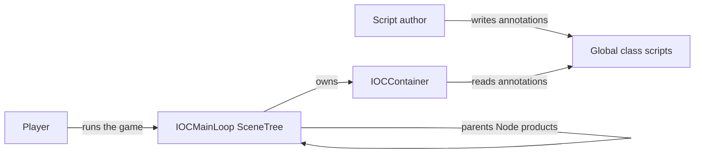
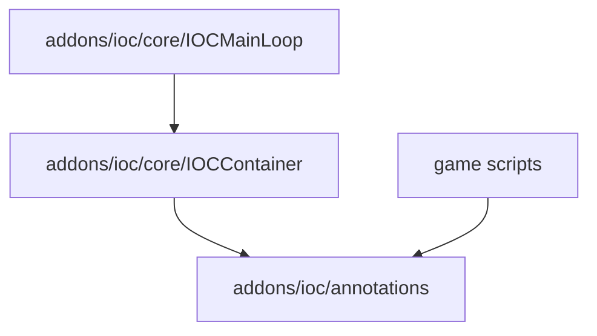
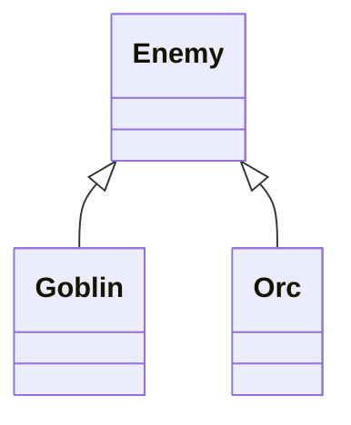
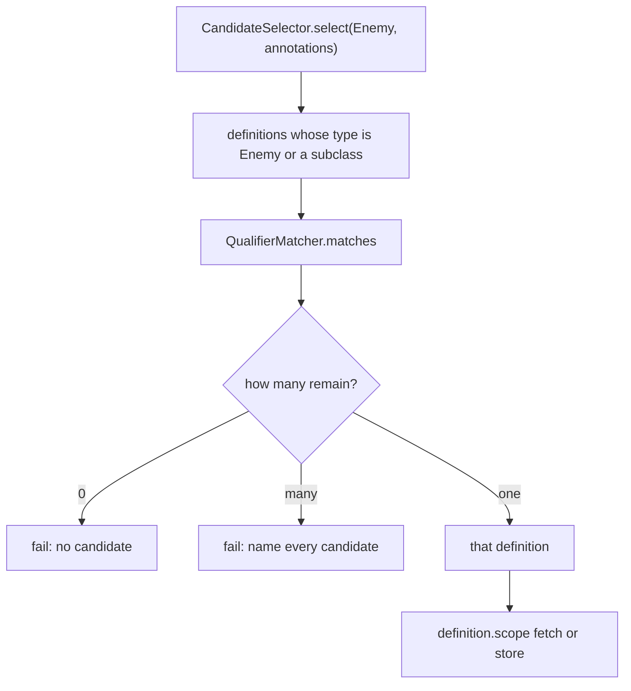
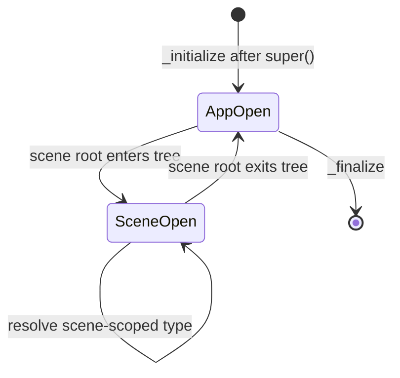

# IOC architecture

Working plan for `addons/ioc` in this project. It uses the user-annotation APIs on Godot branch `cursor/gdscript-user-annotations-8b9e`.

The current stubs still have `Configuration` extending `Component`, and `IOCMainLoop` extending `MainLoop` with no `class_name`. This plan replaces that.

## Decisions

`@Configuration` is a factory. It does not extend `@Component`. The scanner instantiates each configuration class once, at app scope, and treats that object as the factory.

`@Component` is the only product mark.

- On a class, the product is that class. The container calls `new()` on the script.
- On a method, the product is the method's return value. The container calls the method on the factory. This is the factory method. There is no separate `@Bean`.

`@Inject` is the injection mark. It sits on a field, on an `_init` parameter, or on a factory-method parameter. `@Component` does not inject.

A dependency asks for a type. Every registered component whose type is that type, or a subclass of it, is a candidate. One subclass is enough. The parent class does not need its own `@Component`. Godot has no interfaces, so the parent is a base class. The container walks `get_base_script()` to decide.

A factory method's type is the declared return type. `-> Goblin` matches a request for `Goblin` and for `Enemy` when `Goblin` extends `Enemy`. `-> Enemy` matches `Enemy` only. The container does not guess a narrower runtime class from the method body.

When more than one candidate matches, qualifier annotations pick one. `@Qualifier` is the built-in annotation, and its `value` string is an ordinary attribute. A user qualifier is another annotation class that extends `Qualifier`, for example `@Offline` or `@Genre` with its own attributes. The container does not special-case the string. `AnnotationUtils` already returns a subclass use when the query class is the base, so a query for `Qualifier` sees `@Offline` and `@Genre`.

Each qualifier annotation on the injection point must be satisfied by one on the candidate: same annotation class, same attribute values. Extra qualifier annotations on the candidate are fine. Qualifier does not replace the type check. Zero candidates fail. Several candidates and no qualifier annotation on the injection point fail. Several candidates that still match the same qualifiers fail. The failure names the candidate scripts.

The container does not inline that comparison. `QualifierMatcher`, `CandidateSelector`, and `ScopeHandler` are the policies. A custom qualifier annotation uses the default matcher. A user who needs a different comparison subclasses `QualifierMatcher`. Subclassing and calling `super` keeps the default and adds a rule.

Factory-method parameters and `_init` parameters are resolved before the call. `@Inject` fields are filled after `new()` and before the instance is published into its scope. If resolve re-enters a definition already being created, the container fails. It does not build a proxy.

Conditions and profiles are their own annotations. The factory reads every annotation on the class or the method before it registers a definition. `@Profile` means a run mode (client, dedicated server, editor, or a project feature tag). `@ConditionalOn*` means a yes-or-no check against a setting, a registered type, or a node present in the active scope. Those annotations are not folded into `@Component`.

Two scopes:

- **App.** One instance for the process. A `Node` is parented to the scene-tree root. A `RefCounted` is held by the container.
- **Scene.** One instance per instanced scene root, keyed by that root's instance id. Not one instance per `PackedScene` resource.

The scene tree owns one container. The tree owns node lifetime. The container is the lookup index. It holds `RefCounted` instances itself. It does not parent nodes, and it does not keep a second owning reference to a node.

`IOCMainLoop` is a `SceneTree` with a `class_name`, selected by `application/run/main_loop_type`. `_initialize` calls `super()` first, then discovers definitions.

Discovery uses `ProjectSettings.get_global_class_list()`, then `AnnotationUtils` on each script. There is no project-wide annotation index. Scripts with no `class_name`, and inner classes, are out of this scan.

## Context



## Modules

Allowed dependency: annotations depend on nothing in this addon. The container depends on annotations only through `AnnotationUtils` at runtime. The main loop depends on the container. Sample game scripts depend on the annotations. They do not depend on the container type.



## Classes


`Offline` and `Genre` are examples a game writes. They are not part of the addon.

`Configuration` and `Component` are siblings. A component query does not match a configuration. A configuration class can still expose products, because those products are `@Component` methods, not the configuration annotation itself.

## Policies

The container calls a policy object. It does not contain a second copy of the rule.

| Policy | Default | How a user extends it |
| --- | --- | --- |
| `QualifierMatcher` | Same annotation class, same attribute values. Each required annotation needs one match. | A subclass of `Qualifier` needs no new matcher. One global subclass of `QualifierMatcher` replaces the default. |
| `CandidateSelector` | Assignable type, then the matcher. Zero or several remaining definitions fail. | One global subclass replaces the default. That is where a primary rule would live. The default has none. |
| `Condition` | The annotation's `matches` method. | A subclass such as `@ConditionalOnSetting` is the check. The container calls `matches` on each one it finds. |
| `ScopeHandler` | `AppScope` and `SceneScope`. | Every concrete global subclass is installed, including the two built-ins. `@Component.scope` names the handler script. |

Policy classes are found in the global class list before any product is registered. A policy class is not a product. `@Component` on it is ignored. Zero user subclasses of `QualifierMatcher` or `CandidateSelector` keeps the built-in. Two user subclasses of either one fail at startup and name both scripts. `ScopeHandler` does not use that replacement rule, because App and Scene stay present when a user adds another handler.

```mermaid
sequenceDiagram
    participant Loop as IOCMainLoop
    participant Scan as Global class list
    participant Box as IOCContainer

    Loop->>Scan: get_global_class_list()
    Loop->>Box: default QualifierMatcher and CandidateSelector
    alt one user subclass
        Loop->>Box: replace that policy with the subclass
    else several user subclasses
        Loop-->>Loop: fail and name them
    end
    Loop->>Box: install every ScopeHandler subclass
```

`Condition` is the base for later checks (`ConditionalOnSetting`, `ConditionalOnType`, `ConditionalOnNode`). The container does not special-case each name. It asks each condition annotation on the target whether the definition may be registered.

`ComponentDefinition.type` is the component script, or the factory method's declared return type. `qualifiers` is every annotation on that class or method that extends `Qualifier`, each with its attributes. The container keeps a list of definitions. It does not key that list by exact script, because a request for a parent type must see every subclass.

## Type match



`Goblin` and `Orc` are both `@Component`. A dependency typed as `Enemy` sees both. A dependency typed as `Goblin` sees only `Goblin`.



`@Qualifier("brute")` on `Orc` and on the `Enemy` parameter selects `Orc`, because `value` is `"brute"` on both. `@Offline` on `Orc` and on the parameter selects `Orc` with no string. `@Genre("boss")` matches only a candidate whose `@Genre.kind` is `"boss"`. The same parameter with no qualifier annotation fails while both subclasses are registered. If `Goblin` is the only `Enemy`, the parameter needs no qualifier. A custom matcher is what runs inside `QualifierMatcher.matches`. The selector does not know the annotation classes.

## Registration

```mermaid
sequenceDiagram
    participant Loop as IOCMainLoop
    participant Tree as SceneTree
    participant Scan as Global class list
    participant Utils as AnnotationUtils
    participant Box as IOCContainer
    participant Factory as Configuration instance

    Loop->>Tree: super()._initialize()
    Loop->>Box: new IOCContainer
    Loop->>Box: install policies
    Loop->>Scan: get_global_class_list()
    loop each GDScript
        Loop->>Utils: has_annotation(script, Configuration)
        alt configuration class
            Loop->>Factory: script.new()
            Loop->>Utils: for_each_annotation_initialized(Component, script)
            Utils-->>Loop: annotation, FunctionInfo or ScriptInfo
            Loop->>Loop: read Condition, Profile, and every Qualifier subclass on that target
            alt conditions pass
                Loop->>Box: register(ComponentDefinition)
            end
        else class-level Component
            Loop->>Utils: has_annotation(script, Component)
            Loop->>Loop: read Condition, Profile, and every Qualifier subclass on the class
            alt conditions pass
                Loop->>Box: register(producer = script.new)
            end
        end
    end
```

Class-level `@Component` on a `@Configuration` class is ignored. The configuration object is the factory, created above, not a second product.

Method-level `@Component` is valid only on a configuration class. On any other class the scanner skips it.

## Resolve

```mermaid
sequenceDiagram
    participant Node as Caller node
    participant Box as IOCContainer
    participant Select as CandidateSelector
    participant Scope as ScopeHandler
    participant Producer as producer Callable

    Node->>Box: resolve(Type, annotations, fromNode)
    Box->>Select: select(definitions, Type, annotations)
    alt zero or several candidates
        Box-->>Node: fail
    else one candidate
        Box->>Scope: fetch(fromNode)
        alt instance exists
            Box-->>Node: existing instance
        else
            Box->>Box: resolve each producer parameter
            Box->>Producer: call()
            Box->>Box: fill @Inject fields
            Box->>Scope: attach and store
            Box-->>Node: instance
        end
    end
```

The caller passes the node it is running on. The selector runs before the scope cache. `SceneScope` walks parents to the instanced scene root. `AppScope` ignores that root. A scene-scoped `Node` is parented under the scene root. An app-scoped `Node` is parented under the tree root. A `RefCounted` is stored by the handler and is not parented. A user `ScopeHandler` decides its own key, parent, and release.

## Scope lifecycle



`close_scene` calls `release` on every installed `ScopeHandler`. `SceneScope` drops that root's map. A user handler releases whatever key it stored for that root. Node products under the root are freed by the tree. The container does not free them again. `RefCounted` products for that scene are released with the map.

## What the container stores

| Kind | App | Scene |
| --- | --- | --- |
| Node | Child of the tree root. Container stores the lookup. | Child of the scene root. Container stores the lookup. |
| RefCounted | Held in the app map. | Held in the scene map until the root exits. |

## First slice

The first running slice uses only the decisions above that it needs.

It includes `IOCMainLoop` as a `SceneTree`, `@Configuration` separate from `@Component`, discovery of global classes, app scope, class products and factory methods, injection of factory parameters, `_init` parameters, and `@Inject` fields on objects the container itself creates, parent-type matching, and the default qualifier matcher including a user subclass of `@Qualifier`. `QualifierMatcher`, `CandidateSelector`, and `AppScope` exist as the objects the container calls. A factory method with no declared return type is a registration error. A missing or ambiguous candidate is `push_error` with the candidate scripts named, and `resolve` returns null. The sample is one app-scoped `Node`, one `RefCounted`, two subclasses of one parent, and one `@Qualifier` that selects between them.

It does not include scene scope, conditions, profiles, a custom `ScopeHandler`, or a replacement policy. It does not inject nodes the scene file already created. Those nodes exist before `resolve` runs, and this plan does not yet say when their `@Inject` fields would be filled.

## Still open

Which node is the scene-scope root: the nearest ancestor with a `scene_file_path`, or only `current_scene`. The first slice does not choose, because it has no scene scope.

Whether a node placed in a scene receives `@Inject` when it enters the tree. The first slice does not do that.

## Out of this plan

Inner-class scan and scripts without `class_name`. The default selector has no `@Primary`. A user `CandidateSelector` can add one. Concrete `@ConditionalOn*` checks are the next design pass. Each one is a subclass of `Condition`. Profile comparison is a later policy of that same shape. Neither becomes a branch inside the container.
