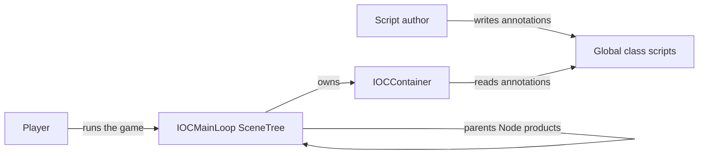
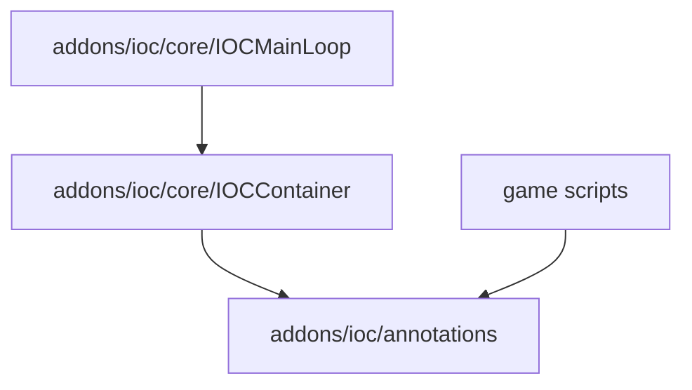
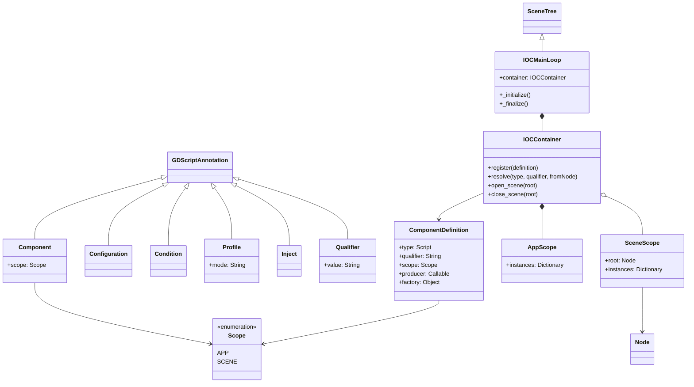
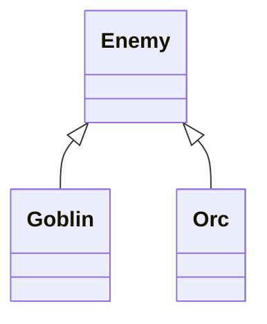
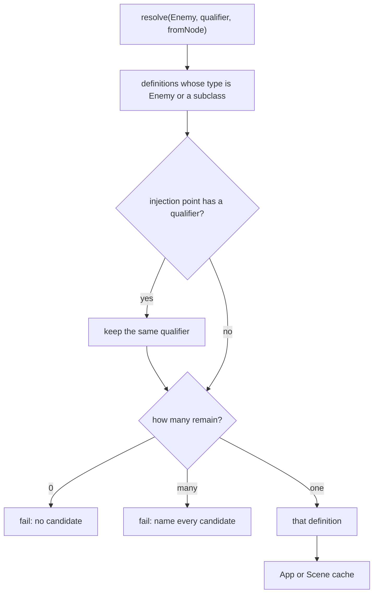
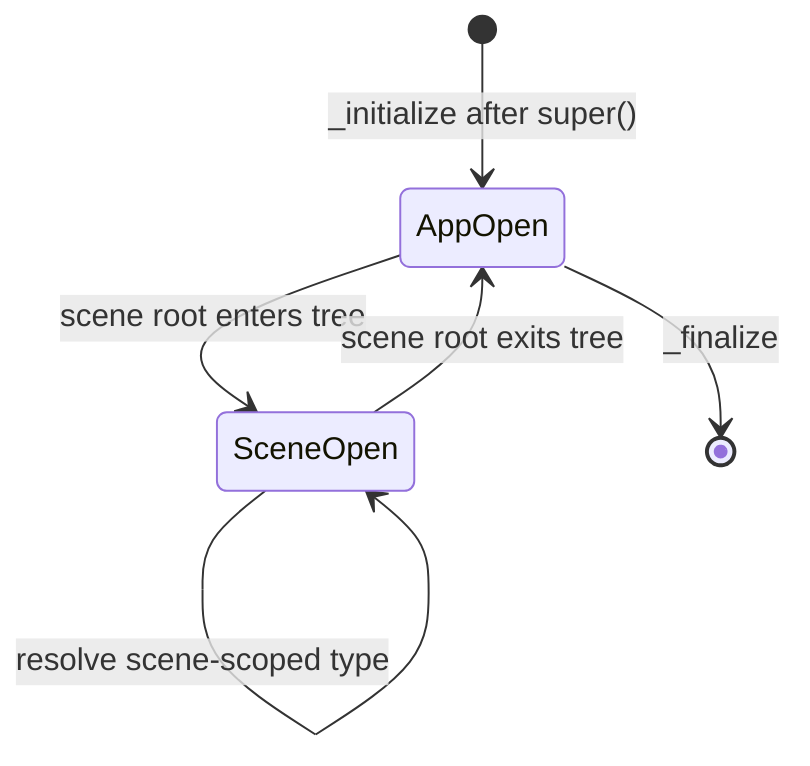

# IOC architecture

Working plan for `addons/ioc` in this project. It uses the user-annotation APIs on Godot branch `cursor/gdscript-user-annotations-8b9e`.

The current stubs still have `Configuration` extending `Component`, and `IOCMainLoop` extending `MainLoop` with no `class_name`. This plan replaces that.

## Decisions

`@Configuration` is a factory. It does not extend `@Component`. The scanner instantiates each configuration class once, at app scope, and treats that object as the factory.

`@Component` is the only product mark.

- On a class, the product is that class. The container calls `new()` on the script.
- On a method, the product is the method's return value. The container calls the method on the factory. This is the factory method. There is no separate `@Bean`.

`@Inject` is the injection mark. It sits on a field, on an `_init` parameter, or on a factory-method parameter. `@Component` does not inject.

A dependency asks for a type. Every registered component whose type is that type, or a subclass of it, is a candidate. One subclass is enough. The parent class does not need its own `@Component`. Godot has no interfaces, so the parent is a base class. The container walks `get_base_script()` to decide.

A factory method's type is the declared return type. `-> Goblin` matches a request for `Goblin` and for `Enemy` when `Goblin` extends `Enemy`. `-> Enemy` matches `Enemy` only. The container does not guess a narrower runtime class from the method body.

When more than one candidate matches, `@Qualifier` picks one. The same annotation sits on the product (the component class or the factory method) and on the injection point. The value is one string. Qualifier does not replace the type check. Two products with the same qualifier and the same parent still fail.

Zero candidates fail. Several candidates and no qualifier on the injection point fail. The failure names the candidate scripts so the author can add the qualifier.

Factory-method parameters and `_init` parameters are resolved before the call. `@Inject` fields are filled after `new()` and before the instance is published into its scope. If resolve re-enters a definition already being created, the container fails. It does not build a proxy.

Conditions and profiles are their own annotations. The factory reads every annotation on the class or the method before it registers a definition. `@Profile` means a run mode (client, dedicated server, editor, or a project feature tag). `@ConditionalOn*` means a yes-or-no check against a setting, a registered type, or a node present in the active scope. Those annotations are not folded into `@Component`.

Two scopes:

- **App.** One instance for the process. A `Node` is parented to the scene-tree root. A `RefCounted` is held by the container.
- **Scene.** One instance per instanced scene root, keyed by that root's instance id. Not one instance per `PackedScene` resource.

The scene tree owns one container. The tree owns node lifetime. The container is the lookup index. It holds `RefCounted` instances itself. It does not parent nodes, and it does not keep a second owning reference to a node.

`IOCMainLoop` is a `SceneTree` with a `class_name`, selected by `application/run/main_loop_type`. `_initialize` calls `super()` first, then discovers definitions.

Discovery uses `ProjectSettings.get_global_class_list()`, then `AnnotationUtils` on each script. There is no project-wide annotation index. Scripts with no `class_name`, and inner classes, are out of this scan.

## Context



## Modules

Allowed dependency: annotations depend on nothing in this addon. The container depends on annotations only through `AnnotationUtils` at runtime. The main loop depends on the container. Sample game scripts depend on the annotations. They do not depend on the container type.



## Classes



`Configuration` and `Component` are siblings. A component query does not match a configuration. A configuration class can still expose products, because those products are `@Component` methods, not the configuration annotation itself.

`Condition` is the base for later checks (`ConditionalOnSetting`, `ConditionalOnType`, `ConditionalOnNode`). The container does not special-case each name. It asks each condition annotation on the target whether the definition may be registered.

`ComponentDefinition.type` is the component script, or the factory method's declared return type. `qualifier` is the `@Qualifier` value on that class or method, or an empty string. The container keeps a list of definitions. It does not key that list by exact script, because a request for a parent type must see every subclass.

## Type match



`Goblin` and `Orc` are both `@Component`. A dependency typed as `Enemy` sees both. A dependency typed as `Goblin` sees only `Goblin`.



`@Qualifier("brute")` on `Orc` and on the `Enemy` parameter selects `Orc`. The same parameter with no qualifier fails while both subclasses are registered. If `Goblin` is the only `Enemy`, the parameter needs no qualifier.

## Registration

```mermaid
sequenceDiagram
    participant Loop as IOCMainLoop
    participant Tree as SceneTree
    participant Scan as Global class list
    participant Utils as AnnotationUtils
    participant Box as IOCContainer
    participant Factory as Configuration instance

    Loop->>Tree: super()._initialize()
    Loop->>Box: new IOCContainer
    Loop->>Scan: get_global_class_list()
    loop each GDScript
        Loop->>Utils: has_annotation(script, Configuration)
        alt configuration class
            Loop->>Factory: script.new()
            Loop->>Utils: for_each_annotation_initialized(Component, script)
            Utils-->>Loop: annotation, FunctionInfo or ScriptInfo
            Loop->>Loop: read Condition, Profile, and Qualifier on that target
            alt conditions pass
                Loop->>Box: register(ComponentDefinition)
            end
        else class-level Component
            Loop->>Utils: has_annotation(script, Component)
            Loop->>Loop: read Condition, Profile, and Qualifier on the class
            alt conditions pass
                Loop->>Box: register(producer = script.new)
            end
        end
    end
```

Class-level `@Component` on a `@Configuration` class is ignored. The configuration object is the factory, created above, not a second product.

Method-level `@Component` is valid only on a configuration class. On any other class the scanner skips it.

## Resolve

```mermaid
sequenceDiagram
    participant Node as Caller node
    participant Box as IOCContainer
    participant Scene as Scene root
    participant App as App scope
    participant Producer as producer Callable

    Node->>Box: resolve(Type, qualifier, fromNode)
    Box->>Box: candidates = assignable type, then qualifier
    alt zero or several candidates
        Box-->>Node: fail
    else one candidate, scope Scene, this root has an instance
        Box-->>Node: existing instance
    else one candidate, scope Scene, this root has none
        Box->>Box: resolve each producer parameter
        Box->>Producer: call()
        Box->>Box: fill @Inject fields
        Box->>Scene: parent Node under the scene root
        Box-->>Node: instance
    else one candidate, scope App, instance exists
        Box-->>Node: existing instance
    else one candidate, scope App, none exists
        Box->>Box: resolve each producer parameter
        Box->>Producer: call()
        Box->>Box: fill @Inject fields
        Box->>App: parent Node under the tree root, or hold RefCounted
        Box-->>Node: instance
    end
```

The caller passes the node it is running on. Qualifier selection happens before the scope cache. Scene scope walks parents to the instanced scene root. App scope ignores that root. A scene-scoped `Node` is parented under the scene root. An app-scoped `Node` is parented under the tree root. A `RefCounted` is stored in the scope map and is not parented.

## Scope lifecycle



`close_scene` drops that root's map. Node products under the root are freed by the tree. The container does not free them again. `RefCounted` products for that scene are released with the map.

## What the container stores

| Kind | App | Scene |
| --- | --- | --- |
| Node | Child of the tree root. Container stores the lookup. | Child of the scene root. Container stores the lookup. |
| RefCounted | Held in the app map. | Held in the scene map until the root exits. |

## Out of this plan

Inner-class scan, scripts without `class_name`, and more scopes than App and Scene. No `@Primary`: several candidates always need `@Qualifier`. Conditions and profiles are named here so the factory has a place to read them. Their concrete checks are the next design pass.
